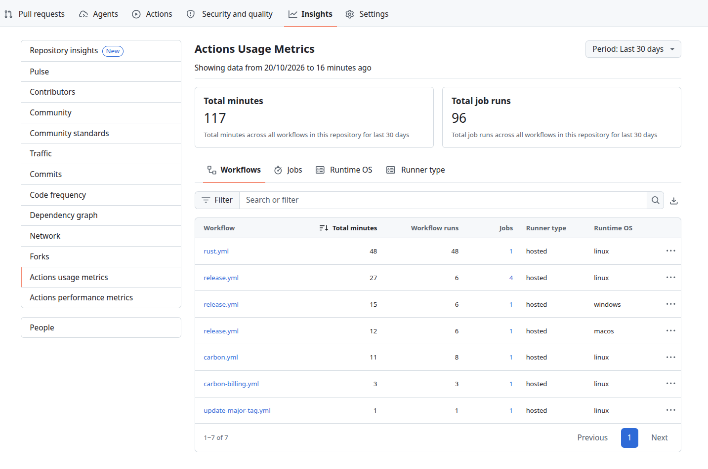

# Methodology

Aspen estimates the energy use, carbon emissions and water consumption of GitHub Actions. It does not measure anything on the runner. It takes the minutes a runner was used (or the storage billed), multiplies them by an estimated power draw, adds the data centre overhead and converts the energy to emissions with an average grid carbon intensity.

```
energy (Wh)  = power (W) × minutes / 60 × PUE
energy (Wh)  = medium (Wh/TBh) × gigabyte hours / 1000 × replication × PUE
co2eq (g)    = energy (Wh) / 1000 × grid carbon intensity (gCO2eq/kWh)
water cooling (L)     = energy (Wh) / 1000 × WUE (L/kWh)
water electricity (L) = energy (Wh) / 1000 × WCF (L/kWh)
```

The first formula covers the compute SKUs, the second the storage ones. The energy is the same for both and already includes the PUE.

## Where the figures live

All the coefficients are in [`resources/config.json`](resources/config.json):

| Key | Value | Unit |
|---|---|---|
| `power_consumption.runners.<runner>.value` | see below | W |
| `storage_energy.ssd.value` | 1.2 | Wh per terabyte hour |
| `storage_energy.hdd.value` | 0.65 | Wh per terabyte hour |
| `storage.skus.<sku>.medium` | `ssd` or `hdd` | key into `storage_energy` |
| `storage.skus.<sku>.replication` | see below | number of copies |
| `grid_carbon_intensity.value` | 384 | gCO2eq/kWh |
| `pue.value` | 1.16 | ratio |
| `wue.value` | 0.34 | litres per kWh |
| `wcf.value` | 3.5781 | litres per kWh |

The file is embedded in the binary at compile time (see [`src/config.rs`](src/config.rs)), so changing a value means rebuilding Aspen. They cannot be overridden at run time yet.

The calculation itself is in [`src/estimator.rs`](src/estimator.rs).

## Input data

Aspen works on usage items with the same shape as the GitHub billing report, whichever source they come from.

### `billing` source

The organisation billing report (`/organizations/{org}/settings/billing/usage`) gives the minutes per day, repository and SKU, as GitHub invoices them. The SKU names the runner type directly (`Actions Linux`, `Actions Windows ARM`...). It also includes storage.

### `jobs` source

Aspen lists the completed workflow runs of the repository over the period, then the jobs of each run. For each job:

- The duration is `completed_at - started_at`, **rounded up to whole minutes** as GitHub does for billing. Jobs that never started, or with no duration, are ignored.
- The runner type is **inferred from the job labels** and mapped to a billing SKU (see `sku_for_labels` in [`src/jobs.rs`](src/jobs.rs)):

| Labels contain | SKU |
|---|---|
| `self-hosted` | `Self-hosted` |
| `ubuntu-slim` | `Actions Linux Slim` |
| `ubuntu` or `linux`, plus `arm` | `Actions Linux ARM` |
| `ubuntu` or `linux` | `Actions Linux` |
| `windows`, plus `arm` | `Actions Windows ARM` |
| `windows` | `Actions Windows` |
| `macos-15-intel`, `macos-26-intel` or `macos-13` | `Actions macOS 4-core` |
| `macos-latest`, `macos-15`, `macos-26`, `macos-14` or `xcode-27` | `Actions macOS 3-core` |
| anything else | the first label |

Labels of larger runners are usually custom names, so they end up in the last row. The macOS labels are those of the [standard runners table](https://docs.github.com/en/actions/reference/runners/github-hosted-runners), matched exactly, with the retired `macos-14` (Apple silicon) and `macos-13` (Intel) added so older runs are still estimated. The macOS larger runners (`-large`, `-xlarge`) are not in the table, so they end up in the last row and get no estimate.

### Checking the input against GitHub

The minutes Aspen uses with the `jobs` source over the default 30 days should match what GitHub shows in the repository, under **Insights → Actions usage metrics** with the period set to **Last 30 days**.



For this repository, GitHub reports 117 minutes over 96 job runs. Each job is rounded up to the minute, as Aspen does. The **Runtime OS** column matches the runner types Aspen infers from the labels. GitHub gives a workflow one row per OS, whereas the per-workflow table of Aspen's summary has one row per workflow file, so the three `release.yml` rows here make a single row of 54 minutes in Aspen.

The emissions only cover the minutes Aspen can estimate (see [What is not estimated](#what-is-not-estimated)). The macOS minutes of `release.yml` are estimated with the macOS figures from [Runner power](#runner-power).

## Runner power

Each SKU is mapped to a runner in `config.json`:

| SKU | Runner | Power (W) | Basis |
|---|---|---|---|
| `Actions Linux` | `ubuntu` | 11.52 | 4 vCPU x86 VM, Azure D4as_v4 |
| `Actions Linux Slim` | `ubuntu-slim` | 2.88 | a quarter of `ubuntu` |
| `Actions Linux ARM` | `ubuntu-arm` | 6.66 | 4 vCPU ARM64 VM, Scaleway COPARM1-4C-16G |
| `Actions Windows` | `windows` | 12.67 | `ubuntu` plus 10% for OS overhead |
| `Actions Windows ARM` | `windows-arm` | 7.33 | `ubuntu-arm` plus 10% for OS overhead |
| `Actions macOS 3-core` | `macos` | 8.47 | 3 of the 8 vCPUs of an AWS `mac2.metal` (Apple M1 Mac mini) |
| `Actions macOS 4-core` | `macos-intel` | 23.35 | 4 of the 12 vCPUs of an AWS `mac1.metal` (Intel Core i7-8700B Mac mini) |

The figures come from [BoaviztAPI](https://github.com/Boavizta/boaviztapi) for these cloud instance types. See [Reproducing the figures](#reproducing-the-figures) for the commands. They are not GitHub's own hardware, which is not published. GitHub's standard hosted runners have had 4 vCPUs since December 2023, hence the choice of 4 vCPU instances.

### macOS runners

GitHub documents the [standard macOS runners](https://docs.github.com/en/actions/reference/runners/github-hosted-runners) as 3 vCPUs and 7 GB of memory on Apple silicon (M1), and 4 vCPUs and 14 GB on Intel. Unlike the Linux and Windows runners, they have the same size for public and private repositories. GitHub runs them on its own Mac fleet, so Aspen uses the closest hardware BoaviztAPI knows about, the Mac mini instances of AWS EC2. Those are bare metal, so BoaviztAPI gives the power of the whole machine and Aspen takes the share that matches the runner, by vCPU count, as it does for the other runners:

| Runner | Host (BoaviztAPI) | CPU | Host power (W) | Share | Runner power (W) |
|---|---|---|---|---|---|
| `macos` | `mac2.metal`, 8 vCPUs, 16 GB | Apple M1, TDP 20 W | 22.59 | 3/8 | 8.47 |
| `macos-intel` | `mac1.metal`, 12 vCPUs, 32 GB | Intel Core i7-8700B, 6 cores and 12 threads, TDP 65 W | 70.06 | 4/12 | 23.35 |

The CPU details are in the [BoaviztAPI CPU specifications](https://github.com/Boavizta/boaviztapi/blob/main/boaviztapi/data/crowdsourcing/cpu_specs.csv). The host averages are about 1.1 times the TDP of each chip, which is a useful sanity check. Splitting by memory instead of vCPUs gives 9.88 W and 30.65 W, so the choice of ratio matters by up to 30%.

Other sources agree on the order of magnitude for the M1 Mac mini. [Apple](https://support.apple.com/103253) rates it at 6.8 W idle and 39 W maximum, measured at the wall. [AnandTech](https://www.anandtech.com/show/16252) measured about 4 W idle and 26.5 W at the wall under a multi-threaded load. Eco-CI, which [carbon-badge](https://github.com/fabiocicerchia/carbon-badge) builds on, has a measured curve for the same machine of 4.45 W idle and 15.53 W at full load. Those are whole-machine figures, so the 8.47 W for a 3 vCPU share is lower than any of the busy values.

Two assumptions are worth knowing about. GitHub does not say how many runners share a Mac, so the share is taken from the vCPU count. If a Mac hosted only two runners, each would account for about half of the host, which is 11.30 W and 35.03 W. BoaviztAPI also returns the same value for `mac2-m2.metal` as for `mac2.metal` and the same for `mac-m4.metal` as for `mac1.metal`, which look like fallbacks, so only the two instances above are used.

The power is the instance's draw at **50% CPU load**. The GitHub APIs give no utilisation figures, so Aspen cannot tell a job compiling flat out from one waiting on the network, and applies the same average load to every minute. 50% sits between the two. A server still draws power when idle, so power does not scale linearly with load. A job running close to 100% for its whole duration will be underestimated, and one that is mostly idle overestimated, but by less than the difference in load suggests.

### Reproducing the figures

With `verbose=true`, BoaviztAPI returns the average power of the instance in watts under `.verbose.avg_power.value`. The calls below use BoaviztAPI 2.6.0 and need `curl` and `jq`. Results may change with new versions of the API, so the version is worth noting when the figures are updated.

```bash
# ubuntu: 11.5225 W (min 3.28 W, max 18.41 W)
curl -s 'https://api.boavizta.org/v1/cloud/instance?provider=azure&instance_type=d4as_v4&verbose=true&duration=1&criteria=fe' | jq '.verbose.avg_power.value'

# ubuntu-arm: 6.6631 W (min 2.58 W, max 10.40 W)
curl -s 'https://api.boavizta.org/v1/cloud/instance?provider=scaleway&instance_type=coparm1-4c-16g&verbose=true&duration=1&criteria=fe' | jq '.verbose.avg_power.value'
```

```bash
# macos: 22.5927 W for the whole host, 8 vCPUs, so 3/8 of it for a 3 vCPU runner
curl -s 'https://api.boavizta.org/v1/cloud/instance?provider=aws&instance_type=mac2.metal&verbose=true&duration=1' | jq '.verbose.avg_power.value'

# macos-intel: 70.0617 W for the whole host, 12 vCPUs, so 4/12 of it for a 4 vCPU runner
curl -s 'https://api.boavizta.org/v1/cloud/instance?provider=aws&instance_type=mac1.metal&verbose=true&duration=1' | jq '.verbose.avg_power.value'
```

The derived runners are `ubuntu-slim` (`ubuntu` / 4), `windows` (`ubuntu` × 1.1), `windows-arm` (`ubuntu-arm` × 1.1), `macos` (22.5927 × 3 / 8) and `macos-intel` (70.0617 × 4 / 12). The values in `config.json` are rounded to two decimals.

### What is not estimated

Usage on any other SKU gets no `energy_usage_wh` or `co2eq_g` and counts as zero in the totals. This applies to:

- self-hosted runners, whose hardware and location Aspen cannot know;
- larger runners and GPU runners, including the macOS `-large` and `-xlarge` ones.

These items are still listed in the report, so you can see how many minutes have no estimate.

## Storage

Items billed in `GigabyteHours` (billing source only) are estimated from the storage medium their SKU is assumed to use and the number of copies kept of the data, with the same PUE and carbon intensity as the runners:

```
energy (Wh) = medium (Wh/TBh) × gigabyte hours / 1000 × replication × PUE
```

| SKU | Medium | Wh per terabyte hour | Replication |
|---|---|---|---|
| `Actions storage` | SSD | 1.2 | 1 |
| `Packages storage` | HDD | 0.65 | 3 |

The energy figures per terabyte hour come from the [SPRUCE storage module](https://opensourcegreenops.cloud/modules/#storage). Actions artifacts and caches are treated as SSD because they are written and read at build speed. Packages are treated as HDD, since a registry serving downloads behaves more like object storage such as S3.

GitHub does not publish how many copies it keeps of either. Packages are counted as three copies, the usual default for object storage, and Actions storage as one, which keeps it as it was before replication was taken into account. Both are guesses, and the single copy for Actions storage is the weaker of the two. Either can be changed in `storage.skus.<sku>.replication` without touching the code.

SKU names are matched in lower case. A SKU billed in gigabyte hours that is not listed in `storage.skus` gets no estimate, and nor does a listed SKU billed in any other unit.

## PUE

The Power Usage Effectiveness accounts for cooling, power distribution and other data centre overhead. Aspen uses 1.16, the value [reported by Microsoft](https://datacenters.microsoft.com/sustainability/efficiency/) for its data centres in the Americas in 2025, since GitHub hosted runners run on Azure.

## Grid carbon intensity

Aspen uses 384 gCO2eq/kWh, the average for the US in 2025 from [Ember](https://ember-energy.org). GitHub does not say which Azure regions its runners use, but most of them are in the US. The figure is a yearly average and does not reflect the time of day a job ran.

## Water

Aspen reports the water **consumed**, meaning water that evaporates and does not return to its source, rather than water withdrawn. The two sources are reported separately, since they happen in different places and are not equally easy to act on.

### Cooling

Water evaporated on site by the data centre cooling systems, computed from the Water Usage Effectiveness (WUE), the litres consumed per kWh of IT energy:

```
water_cooling_l = energy (kWh) × WUE
```

Aspen uses 0.34 L/kWh, the figure [reported by Microsoft](https://datacenters.microsoft.com/sustainability/efficiency/) for its data centres in the Americas, which is also the value [SPRUCE](https://github.com/DigitalPebble/spruce) applies to the US Azure regions. The energy already includes the PUE, so the PUE is not applied again.

### Electricity generation

Water consumed by the power plants that produce the electricity, computed from the Water Consumption Factor (WCF), the litres consumed per kWh generated:

```
water_electricity_production_l = energy (kWh) × WCF
```

Aspen uses 3.5781 L/kWh, the average of the [WRI](https://www.wri.org/data/dataset-guidance-calculating-water-use-embedded-purchased-electricity) factors that SPRUCE holds for the ten US Azure regions (`wcf.csv`), which range from 1.27 to 9.48. It is close to the 3.1 L/kWh quoted by [savethe.ai](https://savethe.ai/water/) and the 4.3 L/kWh in [Construction Physics](https://www.construction-physics.com/p/i-was-wrong-about-data-center-water). Other methodologies fold both sources into one figure (for example [tokenclimate](https://tokenclimate.com/en/methodology), which uses `WUE + PUE × EWIF`). Aspen keeps them apart.

Electricity generation is the larger share, about ten times the cooling figure with these coefficients. It also depends on the grid and not on the data centre, so it falls as the grid moves to wind and solar.

Like the grid carbon intensity, both factors are single averages and ignore which region a job ran in. Water stress is not taken into account, so a litre in a dry region counts the same as one elsewhere.

## Worked example

A 10 minute job on `ubuntu-latest`:

```
energy = 11.52 W × 10 / 60 × 1.16 = 2.227 Wh
co2eq  = 2.227 / 1000 × 384       = 0.855 g
```

The water for the same job, from its 2.227 Wh:

```
cooling     = 2.227 / 1000 × 0.34   = 0.000757 L
electricity = 2.227 / 1000 × 3.5781 = 0.007969 L
```

1,000 gigabyte hours of Actions storage, on SSD and counted as a single copy:

```
energy = 1.2 × 1000 / 1000 × 1 × 1.16 = 1.392 Wh
co2eq  = 1.392 / 1000 × 384           = 0.535 g
```

1,000 gigabyte hours of Packages storage, on HDD and counted as three copies:

```
energy = 0.65 × 1000 / 1000 × 3 × 1.16 = 2.262 Wh
co2eq  = 2.262 / 1000 × 384            = 0.869 g
```

## Outputs

Every usage item that could be estimated gets four fields: `energy_usage_wh` and `co2eq_g`, rounded to three decimals, and `water_cooling_l` and `water_electricity_production_l`, rounded to six. The markdown summary adds them up per repository, per workflow (`jobs` source only) and per SKU, with the two water sources in separate columns. The action outputs `total_water_cooling_l` and `total_water_electricity_l` alongside the energy and emissions totals.

The badge shows the total over the period, in g or kg CO2eq. Its colour shows where the data came from: silver (`c0c0c0`) for the `jobs` source, where minutes and runner types are inferred, and gold for the `billing` source, where they are as billed.

## Limitations

- **Embodied emissions are not included.** Only the electricity used while the runner is busy is counted, not the emissions from manufacturing the hardware or the disks.
- **Storage media and replication are assumed.** GitHub publishes neither, so both come from the defaults of comparable cloud services (see [Storage](#storage)).
- **Network and artifact transfer are not included.**
- **CPU load is not known.** Every minute of a given runner type is priced at 50% load (see [Runner power](#runner-power)), whatever the job was actually doing.
- **The `jobs` source is an approximation.** Durations are rounded up per job and runner types are guessed from labels. The source covers at most 5,000 runs.
- **Water uses one WUE and one WCF for everything.** Neither varies by region, season or water stress (see [Water](#water)).
- **One grid and one PUE for everything.** All jobs are treated as running in the US, at the same time of year.

If you have better figures for any of these, issues and pull requests are welcome.
